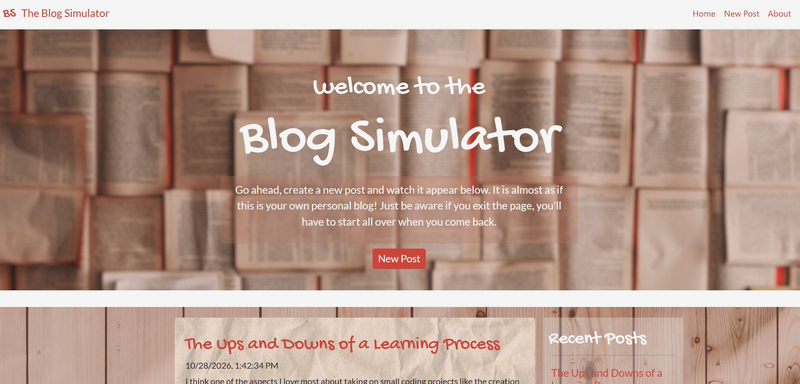
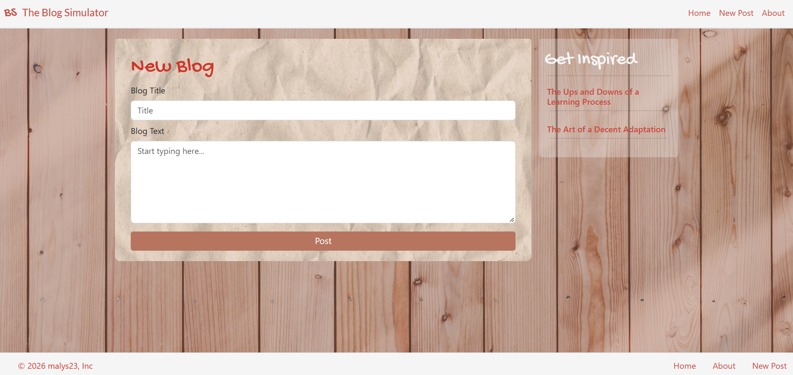
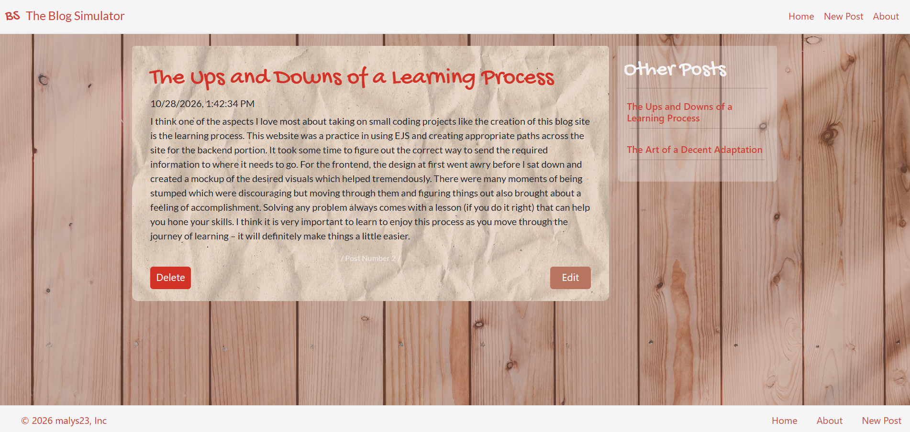

# Blog Simulator
 
A server-rendered blog web application built with Node.js, Express and EJS. Visitors can write, read, edit and delete posts, all in a styled, responsive interface.
 
**Live demo:** [blog-simulator.onrender.com](https://blog-simulator.onrender.com/)
 
> The demo runs on a free hosting plan, so the first load after a period of inactivity can take up to a minute while the server wakes up.
 

 
## What it does
 
The home page shows a list of recent posts with a button to write a new one. A post has a title and text, and shows the time it was last saved. Each post has its own page, with Edit and Delete buttons and a sidebar linking to the other posts.
 
Posts are kept in the server's memory, not in a database. They are shared by everyone who visits the site, and they disappear when the server restarts. This was part of the original brief, and it kept the project focused on routing, templating and application state.
 
## Features
 
- Create new posts with a title and body
- View all posts on the home page, with a "Recent Posts" sidebar
- Open any post on its own page
- Edit and delete existing posts
- Shared header and footer, built as EJS partials
- Styled with plain CSS, split into separate files for layout, content and base styles

## Tech stack
 
| Layer | Technology |
| --- | --- |
| Runtime | Node.js |
| Server and routing | Express.js |
| Templating | EJS (server-side rendering) |
| Styling | CSS |
| Hosting | Render |
 
## Screenshots
 
| New post | Post page |
| --- | --- |
|  |  |
 
## Project structure
 
```
public/
  images/                  background and page images
  styles/
    main.css               base styles
    layout.css             page layout
    content.css            posts, cards and buttons
views/
  partials/
    header.ejs             shared navigation
    footer.ejs             shared footer
  index.ejs                home page and post list
  thePost.ejs              new post and edit form
  view.ejs                 a single post
  about.ejs                about page
index.js                   Express server, routes and in-memory post storage
```
  
## Routes
 
| Method | Path | Purpose |
| --- | --- | --- |
| GET | `/` | Home page with all posts |
| GET | `/thePost` | New post form |
| POST | `/submit` | Create a post |
| GET | `/view/:id` | View one post |
| GET | `/edit/:id` | Edit form for a post (reuses the new post form) |
| POST | `/update` | Save changes to a post |
| POST | `/delete` | Delete a post |
| GET | `/about` | About page |
 
Posts are identified by their position in the list.
 
## Run it locally
 
Requires [Node.js](https://nodejs.org/).
 
```bash
git clone https://github.com/malys23/blog-simulator.git
cd blog-simulator
npm install
npm start
```
 
Then open `http://localhost:8000` in your browser. Set the `PORT` environment variable to use a different port.
 
## Project background
 
This is a capstone project from a Udemy web development bootcamp. The course provides only a written brief (a blog built with Node.js, Express and EJS, with posts that do not persist) and an example site. There are no starter files, styling or solution code, so the planning, routes, templates and design are my own work.
 
I started with a mockup of the design before writing the pages. My first attempt at the front end had gone off course, and the mockup fixed that.
 
## Limitations and next steps
 
- **Posts are not saved.** They live in server memory and are lost when the server restarts. The next step is a real database, such as PostgreSQL or MongoDB.
- **No accounts.** Anyone who visits can edit or delete any post. Adding login, with each post owned by its author, would fix this.
- **Little input validation and no tests.** Next I would validate form input on the server, and add tests for the routes.
- **Posts are identified by their position in the list.** Deleting a post changes the numbers of the ones after it, so two people editing at the same time could end up changing the wrong post. Giving each post a unique ID would fix this.
- **The two sample posts** are created when the server starts, so they share a timestamp.

## What I learned
 
- Building CRUD (create, read, update, delete) features with Express routes and EJS templates
- Managing application state without a database, and where the limits of that approach are
- Splitting a page into EJS partials so the header and footer are written once
- Planning the design first. A mockup saved far more time than fixing the layout afterwards

## Assets and credits
 
- Project brief: capstone project from a Udemy web development bootcamp.
- Wooden background: [photo](https://unsplash.com/photos/a-close-up-of-a-wooden-wall-with-a-light-shining-on-it-X-Bu9X6gok0) by Bernard Hermant on Unsplash
- Home page banner (open books): [photo](https://unsplash.com/photos/open-book-lot-Oaqk7qqNh_c) by Patrick Tomasso on Unsplash
- Paper texture on the post cards: [photo](https://unsplash.com/photos/a-piece-of-white-paper-that-is-crumpled-in-half-o_aQ_vBDwOc) by Bart Wesolek on Unsplash
- Binder clip: [icon](https://www.flaticon.com/free-icon/binder-clip_7178484) by Prosymbols Premium from Flaticon
- Fonts, loaded from Google Fonts under the [SIL Open Font License 1.1](https://openfontlicense.org/open-font-license-official-text/): Gochi Hand by Juan Pablo del Peral, and Lato by Lukasz Dziedzic (tyPoland)

## Contact
 
Alyona M · [LinkedIn](https://www.linkedin.com/in/amaliassova)